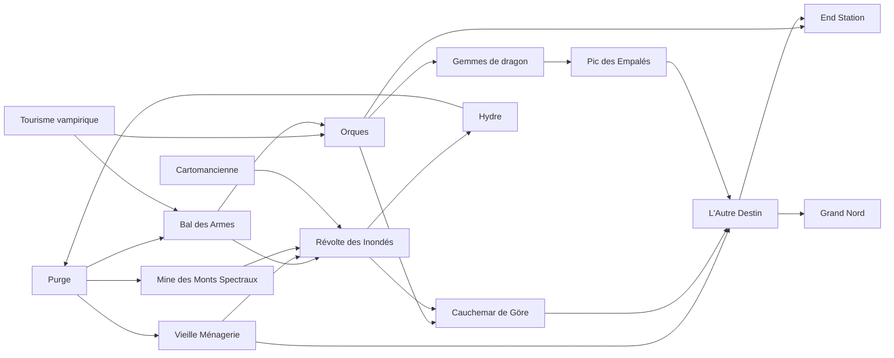

# Carte des blocs — Les Trames du Onzième

> **CONFIDENTIEL — RÉSERVÉ AU MAÎTRE DE JEU**
> Carte sommaire. Les blocs se jouent dans n'importe quel ordre ; chacun ouvre une ou deux connexions vers d'autres. Le MJ les raccorde à l'improvisation, selon ce que veulent les joueurs.

---

## Le principe

- **Un bloc = une situation**, avec ses PNJ, son lieu, son horloge et sa résolution propre. On peut le terminer sans rien savoir des grands secrets.
- **Les connexions sont des portes**, pas des rails : un PNJ qui passe d'un bloc à l'autre, un objet, une rumeur, un commanditaire commun. Le groupe peut continuer dans son bloc ou franchir une porte.
- **Pour les joueurs, la structure est invisible.** Ils déjouent un attentat sans apprendre quoi que ce soit du Rêve, du Nouveau Monde ou du Pape-Dragon. Les secrets de fond se gagnent en suivant les connexions, pas en finissant les blocs.
- **Une table qui veut tout faire joue « plein de petits bouts de blocs ».** C'est normal. Limitez seulement le nombre de fronts actifs (trois au plus), et laissez les autres avancer seuls sur leur horloge.

### Raccorder un bloc à l'improvisation

| Levier | Exemple |
|---|---|
| **Un PNJ passeur** | Hans d'Aragon apparaît au Bal des Armes alors qu'on le cherchait en Terre-Tapinois |
| **Un objet** | le carnet d'Eichel cite un trafic d'armes à Kristalblum : la Purge mène au Bal |
| **Un commanditaire** | Hahn, Göre, Auge ou le Silence confient la mission suivante |
| **Une horloge qui sonne** | un bloc ignoré avance : les orques débarquent, le rituel s'achève, la révolte éclate |
| **Un historique de PJ** | avec l'accord du joueur, son passé ouvre une porte (le pendentif lunaire d'Althaïr) |
| **Un échec** | un échec ne ferme pas la porte : il en ouvre une autre, plus chère |

---

## Les portes d'entrée de la campagne

Le scénario 01 (la Purge) part par défaut du **Secret**, la police de Göre. Mais le même meurtre peut ouvrir la campagne pour d'autres groupes : seul change **ce que les PJ veulent en faire**.

| Les PJ sont… | Commanditaire | Ce qu'ils veulent | Ce que la Purge devient pour eux | Blocs favoris ensuite |
|---|---|---|---|---|
| **le Secret** (défaut) | la Comtesse Göre, via Jacques la Savate | protéger la ville et leur patronne | **étouffer** ce qui remonte à Göre | Bal des Armes, Orques |
| **des agents d'Auge** | le Comte Auge (l'Œil) | savoir, et l'immortalité que cherche Auge | retrouver l'**anneau-sceau volé** à la Dévoterie (le vol a été signalé à Auge) et mettre la main sur le **Codex** | Arbre de métal, Hydre |
| **des explorateurs du Nouveau Monde** | Tumo Schlafkrankheit, l'Eau Calme, le Comte Jagenwilde | fortune, concessions, savoir | identifier le **poison** et la **bête de la ménagerie** : une créature de l'ancien Königsfell, qui intéresse les collectionneurs | Gemmes de dragon, Pic des Empalés, Orques |
| **des Akkadiens** en quête du corps du Roi de la Nuit | une famille des Inondés, un prêtre comme Ussuru | rendre son corps au Roi, laver leur peuple des accusations | le meurtrier profane un **temple akkadien** et des runes de fusion ; on accusera les Akkadiens : il faut le prendre avant | Révolte des Inondés, Ménagerie, Cauchemar de Göre |
| **des agents de l'Empire** au service du Silence | un Apôtre, frère Wanderer, un officier impérial | déstabiliser Königsfell en faisant **tomber Göre** et ses agents | les mêmes indices, au service du but inverse : **prouver** le crime de la Purge | Bal des Armes (côté Silence), Mine des Monts Spectraux |
| **des enfants du Rêve** | Überlieben, par la voix d'un rêve (comme Terry) | répondre à l'appel, partir vers l'**Arbre de métal** ou le **Grand Nord** | le Codex est un fragment du Rêve, et Giorgio a été guidé par Überlieben : il faut récupérer le livre, ou envoyer les morts dans le Rêve | Arbre de métal, End Station, Grand Nord |

> **Note MJ :** on peut mélanger. Un groupe du Secret peut compter un enfant du Rêve qui ne le sait pas encore ; un agent du Silence infiltré dans le Secret donne une campagne de paranoïa. Proposez-le au joueur, avec son accord, sans dévoiler le reste.

---

## Les blocs

| Bloc | Enjeu | Entrées | Connexions | État |
|---|---|---|---|---|
| **La Purge** ([scénario 01](scenarios/01-meurtre.md)) | un descendant des victimes de Göre tue les héritiers des juges | porte d'entrée de la campagne | Bal des Armes (carnet d'Eichel), Ménagerie (le poison), Mine (Proteo) | écrit |
| **Tourisme vampirique** | une vampire des royaumes de l'Est veut un sauf-conduit ; les Enfants de la Lune et Hans d'Aragon | une fugitive enceinte, une pièce noire, le pendentif lunaire | Bal des Armes (les Imondi au rallye, Hans), Orques (le calendrier impérial) | joué, notes |
| **Le Bal des Armes** ([scénario 02](scenarios/02-bal-des-armes.md)) | un attentat au feu grégeois, financé par Hans d'Aragon contre l'Empereur | le hangar des docks, Verita, le rallye | Orques (le mithril de Korfan, vendredi), Révolte des Inondés (armes de Lapis) | écrit |
| **Les orques du Nouveau Monde** ([fiche](blocs/orques.md)) | débarquement, sabotage, cacher l'orque, fête et chasse impériales ; ce que devient l'orque (allié, monstre ou spores d'une reine) | Göre ou Hahn confient la mission | Gemmes de dragon (Tumo), Cauchemar de Göre, End Station, Hydre (le phylactère d'Auge) | fiche |
| **La Vieille Ménagerie** | Antonio il Pazzo, le Roi des Damnés, et les bêtes de l'ancien Königsfell | la piste du poison | Révolte des Inondés, Arbre de métal | notes |
| **La révolte des Inondés** | les Akkadiens refusent la venue de l'Empereur tant que dure le blocus ; l'île des Décédés ; frère Bartolo, agent du Rêve | les armes vendues aux Inondés, le couvre-feu | Cauchemar de Göre, Hydre | notes |
| **Le Cauchemar de Göre** | entrer dans le rêve de Göre, revivre ses épreuves de pupille ; Lucie | Göre au bord de la rupture | Arbre de métal, Orques | joué |
| **L'Autre Destin** | l'arbre de métal iridescent qui pousse dans la cathédrale et se nourrit des Erlöser ; les malédictions de la nuit | Elias Havek et Salvo Tenore (ordre de l'Aube) | End Station, Grand Nord | notes |
| **End Station** ([fiche](blocs/end-station.md)) | la tour-taverne de non-droit, le Mortarbre et le onzième étage (le néant), la Mousse sortie du Rêve, la Comtesse Zotten qui veut disparaître | Hahn (retrouver la Ribaude avant les fêtes), la Bergerie | Arbre de métal, Hydre, Grand Nord (le portail vers le Rêve) | fiche |
| **Le Pic des Empalés** ([fiche](blocs/pic-des-empales.md)) | la mission de l'Eau Calme massacrée ; une baleine-cité d'un autre monde échouée, les Suifs déguisés dans la peau des morts | l'Eau Calme, le capitaine Sandergul | Gemmes de dragon, Hydre, Grand Nord (le vortex) | fiche |
| **La mine des Monts Spectraux** | le palladium, que le Silence exploite pour ses soldats | Proteo, Oyuun, Korfan | Révolte des Inondés (l'assèchement du Gouffre), Pape-Dragon | esquisse |
| **Les gemmes de dragon** | Tumo a trouvé au Nouveau Monde des cristaux que les dragons bénissaient ; il cherche un drakéide | Tumo au bal, un PJ drakéide | Pic des Empalés, Orques | notes, joué en partie |
| **L'Hydre** | la guilde des meilleurs profils, chambre de onze représentants ; le siège vacant de Kette | l'Empereur veut dissoudre l'armée ; Hahn la subdivise | La Purge (une nouvelle couverture), Révolte | notes |
| **La Cartomancienne** | ses cartes et ses runes volées par des rebelles, dans un hangar des docks | une prédiction | Révolte des Inondés | esquisse |
| **Le Grand Nord** | la cité avancée sous le permafrost, qui tirait son énergie des Erlöser ; la source du Rêve, où l'on pourrait **l'éteindre** ; Zeichen, guide pour trouver Kette dans le Rêve (ou pour tuer Lucie) | l'Arbre de métal, les enfants du Rêve, Jagenwilde (seul à pister Zeichen) | — (fin de campagne) | à écrire |

---

## Les secrets de fond

Chaque bloc touche à un ou deux secrets, jamais à tous. Les joueurs les reconstituent par morceaux.

| Secret | Blocs qui y touchent |
|---|---|
| **Göre et la Purge** : le crime d'une Iggigi, pupille de l'Empereur | Purge, Cauchemar de Göre, Bal des Armes |
| **La succession impériale** : Willensein populaire, le camp Vauburg qui gagne du temps, Hans qui finance un meurtre | Bal des Armes, Tourisme vampirique, Orques |
| **Le Rêve et Überlieben** : le Rêve est un monde virtuel créé par **Zeichen**, dernier survivant d'une cité du Nord qui tirait son énergie des Erlöser. Kette l'a rejoint en se sacrifiant et y est devenu Überlieben : il gagne du temps en provoquant des catastrophes qui nourrissent les Erlöser, et recrute des agents pour « sauver » les gens dans le Rêve. Mais les Erlöser se nourrissent aussi de sa magie. Kette est le **Maître des rêves** ; Zeichen ignore qu'il est là | Purge (le Codex), Cauchemar de Göre, End Station, Arbre de métal |
| **Le Nouveau Monde et les tsunamis** : la première vague est née du tsunami lancé par les hommes-lézards contre les orques ; les suivantes naissent de la ferveur des orques, qui prient les Erlöser ; les Erlöser, parasites stellaires, mangent l'énergie et le chaos, et grossissent avant chaque vague | Orques, Gemmes de dragon, Pic des Empalés |
| **Le Pape-Dragon** : le palladium, les Basilics, le Silence | Mine des Monts Spectraux, Cauchemar de Göre, Révolte |

---

::: dev
**Source :** `prive/notes-drive/Scenariotheque/` (un dossier par bloc) et les deux campagnes jouées en 2020–2021. Le secret d'Überlieben vient des notes `___00_MainTropes`, complétées par le MJ (Zeichen et la cité du Nord, 2026-10-11). Les blocs « esquisse » et « à écrire » n'ont que quelques lignes de notes.

**Fiches écrites :** [orques](blocs/orques.md), [End Station](blocs/end-station.md), [Pic des Empalés](blocs/pic-des-empales.md) (2026-10-15).

**À faire :** une fiche pour chacun des autres blocs (enjeu, entrées, horloge, connexions).
:::

[Scénario 01](scenarios/01-meurtre.md) · [Scénario 02](scenarios/02-bal-des-armes.md) · [Campagne](pitch.md)
