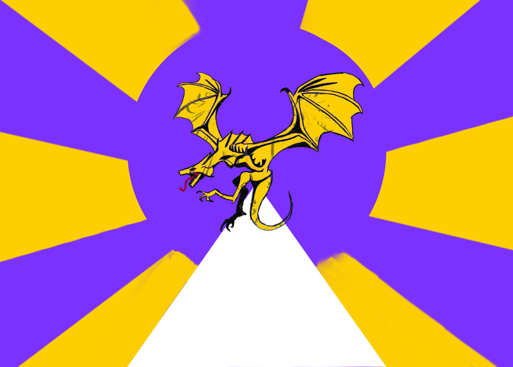

# L'Empire d'Alammania

*Ce que les voyageurs de Königsfell doivent savoir de l'Empire. Pour son histoire, voir la [Chronologie](timeline.md).*

> Page en cours : on y rassemble les notes de lore données aux joueurs.

---

## Le drapeau

Le drapeau de l'Empire montre une **vouivre d'or** qui **rayonne** au sommet d'une **pyramide blanche**, sur un soleil de rayons violets et or. La vouivre est l'Empire ; la **pyramide**, c'est la religion d'**Ewald**, sur laquelle il se dresse. On la retrouve partout : sur les pièces (queue de bronze, aile d'argent, dent d'or), au-dessus des Officines, que le peuple appelle Auberges de la Vouivre, et dans la *pyramide-clef* que portent les théurges du Silence.

---

## Le Silence

L'inquisition impériale, chargée du contrôle de la magie et de l'ordre public. Ses soldats suivent trois voies, qui partent toutes de l'**Initié**. Les pouvoirs des ordres greffés de palladium sont décrits dans [Les sens du Silence](../regles/magie.md#les-sens-du-silence).

- **Initié**
  - **Milicien**
    - **Soldat**
    - **Dévot**
      - **Missionnaire**
      - **Prêcheur**
        - **Prédicateur** : un soldat à la tête d'une forteresse ou d'une région.
  - **Pénitent**
    - **Soupir**
      - **Basilique** : le soldat aux pieux dans les yeux.
      - **Sirène** : le soldat télépathe, qu'on appelle aussi **inquisiteur**.
      - **Témoin** : l'assassin, spécialisé dans la traque des mages.
      - **Criquet** : le disrupteur de magie.
        - **Voûte** : souvent à la tête d'une région, comme le Prédicateur, mais capable de lancer des sorts.
          - **Apôtre** : les représentants directs du Pape, aux doigts, à la langue et aux yeux de palladium.
    - **Murmure** : un moine reclus.
- **Pape** : la plus haute autorité.

**Les Apôtres** sont sept. On les appelle « les yeux et la bouche » du Pape, qui reste invisible et ne sort que pour couronner l'Empereur.

::: mj
À la table (*Le Sucret*, épisodes 9, 10 et 16) : l'Apôtre reçoit le groupe dans une salle hermétique au son et à la magie, bénit d'une poussière d'argent, et la table soupçonne que le Pape et les Apôtres peuvent **habiter d'autres corps** ; le MJ confirme que les Apôtres « représentent la magie ». Le Pape est le Pape-Dragon d'Ewald (voir `mj/timeline.md`).
:::

---

## Tastesperren et Officines

**On ne voyage pas dans l'Empire sans papiers officiels.** Ces papiers, c'est le **Tastesperren**, le visa. Tout étranger qui entre dans l'Empire, voyageur, marchand ou simple individu, doit le faire viser dans une **Officine**.

**L'Officine.** Le peuple l'appelle **l'Auberge de la Vouivre** : c'est le plus souvent un gîte et un débit de boisson, au-dessus duquel flotte le drapeau de l'Empire. On y fait viser ses papiers.

**L'itinéraire.** En entrant dans l'Empire, le voyageur déclare où il va. L'Officine lui fixe une **série d'Officines** par lesquelles il devra passer, chacune **dans un temps imparti**. Tout détour, tout retard peut être sanctionné.

**L'Augenzeugin.** Pour éviter les ennuis, on peut embaucher une **Augenzeugin**, un guide qui veille sur la bonne conduite des étrangers. Elle connaît les Officines, les délais et les gens qui comptent ; elle est aussi les yeux de l'Empire sur ceux qu'elle guide.

**Pour un groupe.** Un voyage dans l'Empire est une course contre l'itinéraire. Un détour pour une mission, une nuit perdue, un compagnon sans papiers : tout se paie à l'Officine suivante. Un [sceau officiel](../regles/armurerie.md#les-sceaux-officiels) aide à passer ; un faux papier aussi, jusqu'au jour où il ne passe plus.

::: mj
**À la table.** Dans *Le Sucret* (épisode 22), le groupe s'arrête à **Offlichtenburg** ⚠, près de la Citadelle de l'Aube : l'auberge, l'*Entinden* ⚠, est une Officine, tenue par Hugues, un énorme barbu, et son épouse naine Alicia, qui entretient les fortifications. Les étrangers y font viser leur passeport : on ne circule pas dans l'Empire sans être citoyen.

À ne pas confondre avec l'**officine** d'un apothicaire (la planque du Physicus) : même mot, autre chose.
:::

---

[← Retour à l'accueil](../index.html) · [Chronologie](timeline.md) · [Glossaire](glossaire.md) · [La Cité](lieux/konigsfell-ville.md)
